# HEX Revival

Play **HEX: Shards of Fate** again, solo against the AI or online against other players, now that the official servers
are gone (December 2020). **[Download the latest release](https://github.com/Theveninm/Hex-shard-of-fates-revival/releases/latest)** · **[Discord server](https://discord.gg/4TWeErkhe)**

HEX Revival is a mod: it does not include or modify any game file. It adds a small loader
([BepInEx](https://github.com/BepInEx/BepInEx)) and the HexRevival plugin next to `Hex.exe`,
and rebuilds locally what the server used to do: game rules, AI opponent, your collection and your decks.

## Feature highlights

<table>
<tr><td width="50%">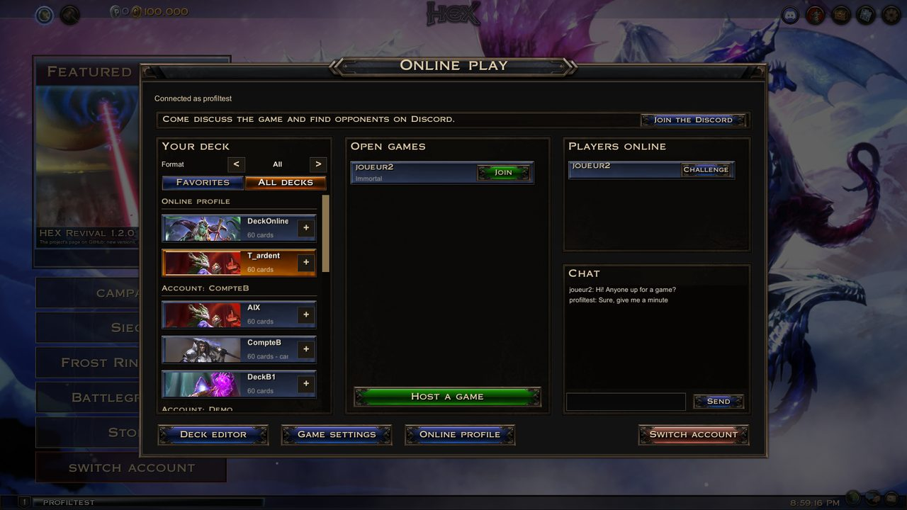 <b>Online lobby</b> Open games, challenges, players online and chat, through the community server. No port to open.</td><td width="50%">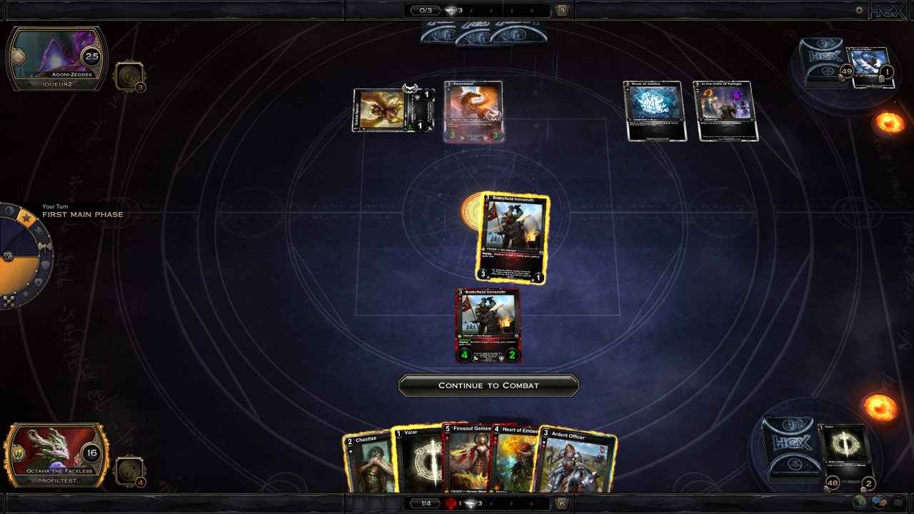 <b>Play against other players</b> The host runs the game, the server relays it. Each side shows the player's name.</td></tr>
<tr><td width="50%">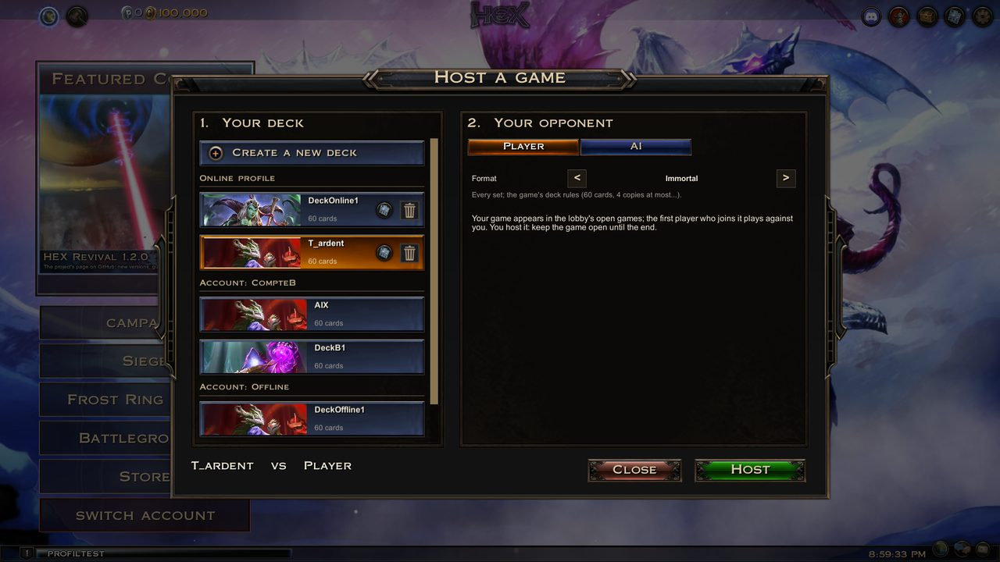 <b>Host a game</b> Against another player in Immortal, Standard, PvE or free format, or against the AI with any of your decks.</td><td width="50%">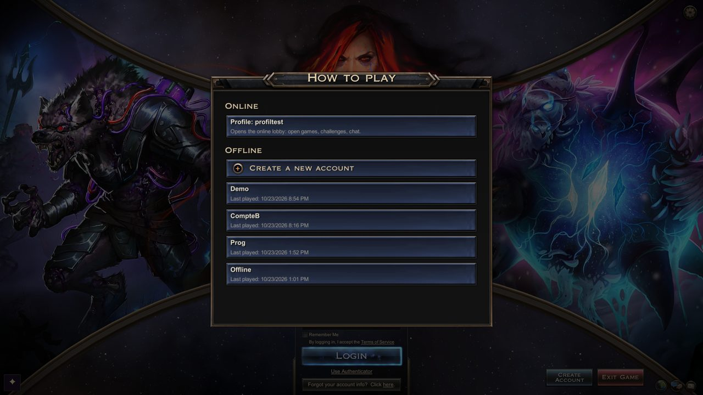 <b>Online play or offline accounts</b> Each offline account keeps its own collection, decks and campaign.</td></tr>
<tr><td width="50%">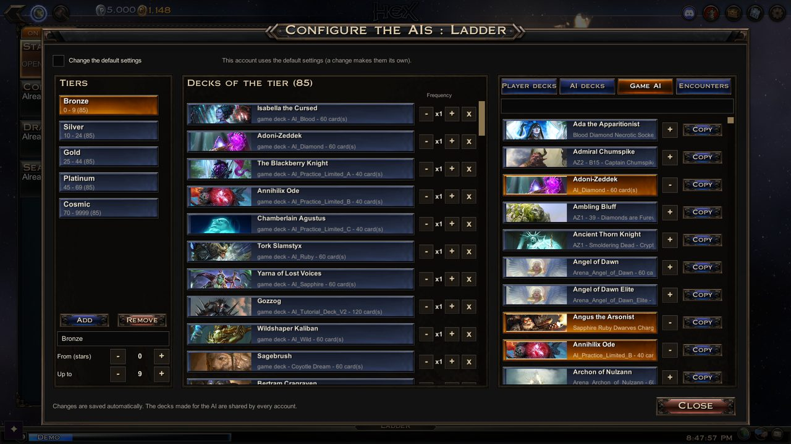 <b>Configure the AIs</b> For each mode and tier, which decks the AI plays and how often.</td><td width="50%">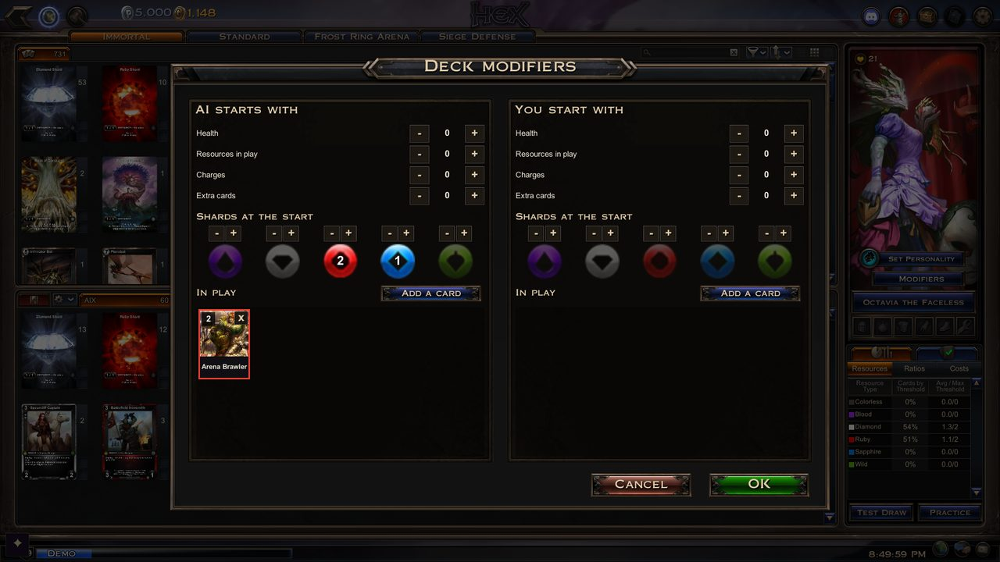 <b>Deck modifiers</b> Give the AI or yourself a head start: health, resources, charges, extra cards, shards, cards in play.</td></tr>
<tr><td width="50%">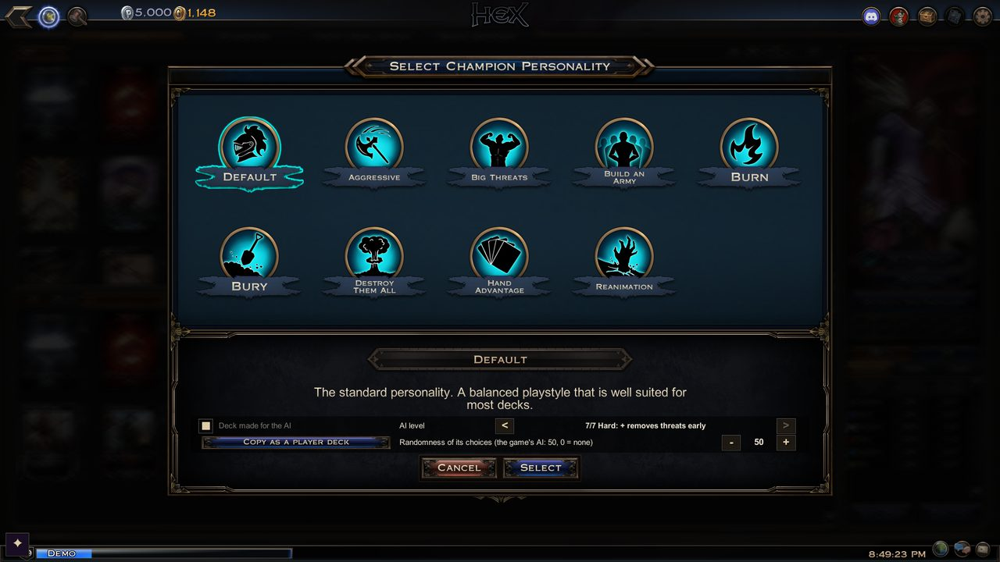 <b>AI level per deck</b> A deck's personality, how strong the AI plays it and how random its choices are.</td><td width="50%">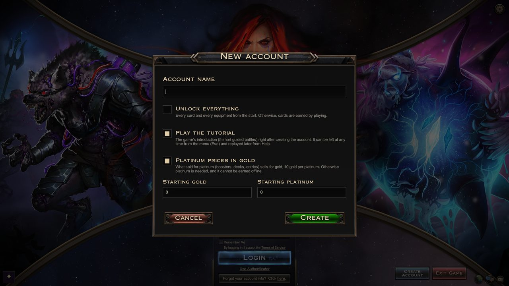 <b>Offline accounts your way</b> Everything unlocked or cards earned by playing, tutorial, starting gold.</td></tr>
<tr><td width="50%">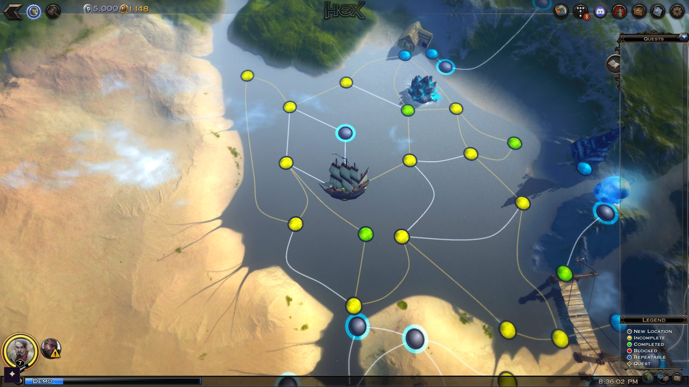 <b>The campaign is back</b> The Howling Plains and the Alachian Sea: quests, hubs, dialogues, the ten dungeons, mercenaries, your own ship.</td><td width="50%">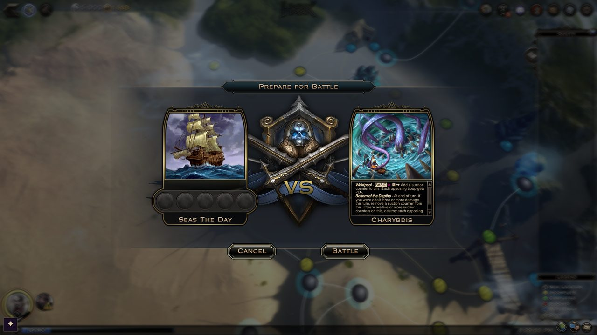 <b>Sea voyages</b> Ship battles against the creatures of the Alachian Sea.</td></tr>
<tr><td width="50%">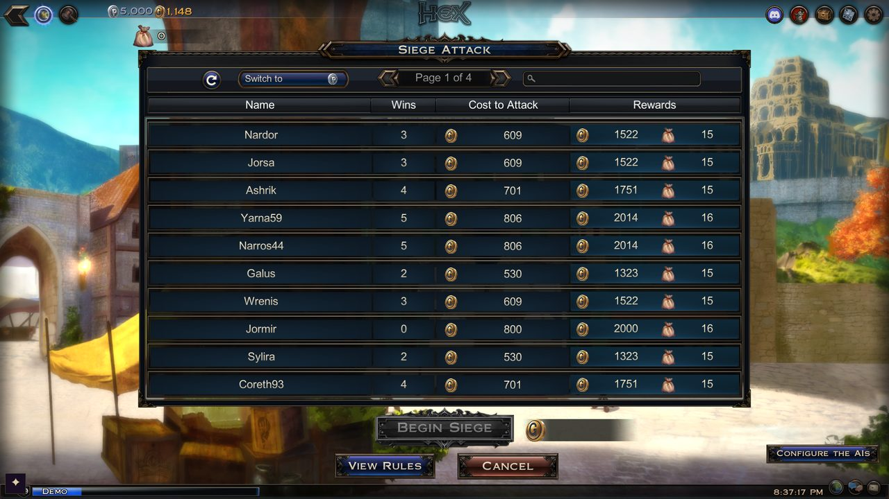 <b>Siege</b> Attack defenses for their bounty, or commit your own defense of 3 decks played by the AI.</td><td width="50%">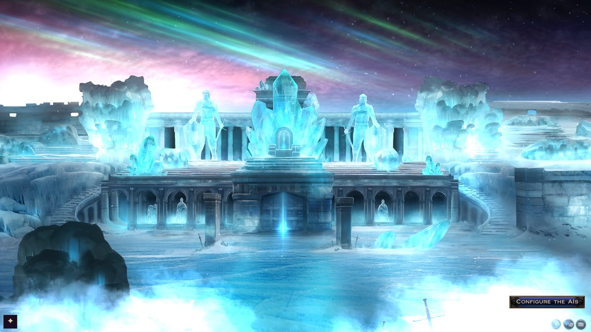 <b>Frost Ring Arena</b> The PvE boss rush: 20 fights in 4 tiers, on the game's own arena screens.</td></tr>
<tr><td width="50%">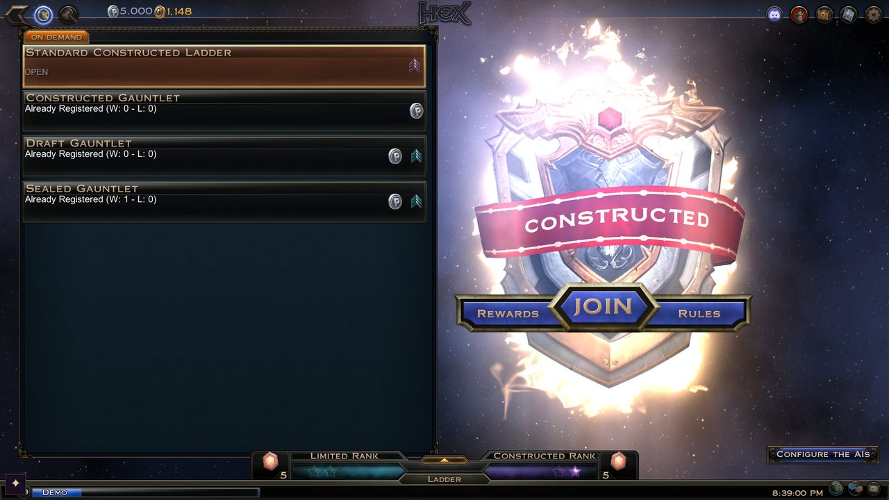 <b>Battlegrounds</b> Constructed, sealed and draft gauntlets and the ladder, against the AI.</td><td width="50%">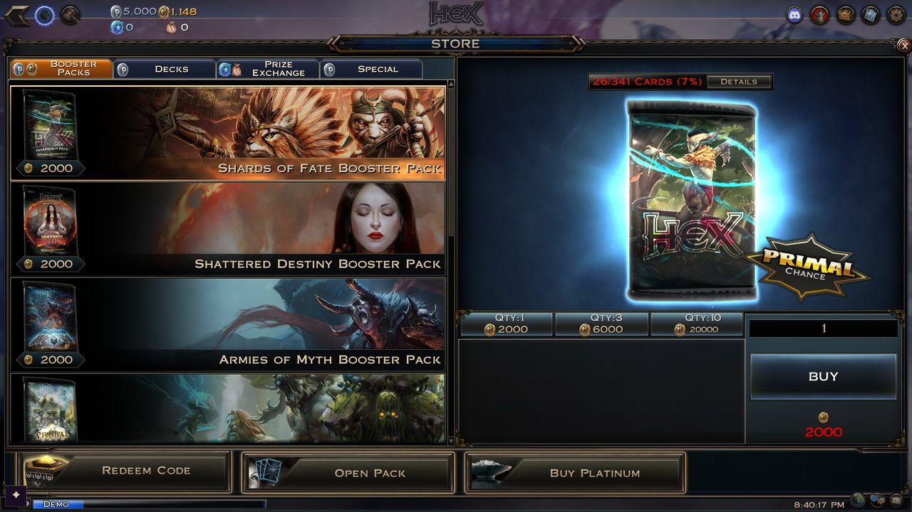 <b>Store</b> Boosters, preconstructed decks, Prize Exchange, primal packs and battleboards, for gold.</td></tr>
</table>

## What you get

- **Start screen**: online play, or an offline account (create one: everything unlocked or earned by playing,
  tutorial, starting gold).
- **Campaign**: a new champion starts in its race's hometown (story, sparring match, the quest to Castle Crayburn),
  then your campaign champions play on the game's own world maps, the Howling Plains (AZ1) and
  the Alachian Sea (AZ2, reached by boat), with their quests, hubs and dialogues, the ten dungeons
  (Castle Crayburn to the Ruins of Kukatan), mercenaries, and the sea voyages of your own ship.
  Rewards follow what gameplay videos of the original game show (see [docs/PROGRESSION.md](docs/PROGRESSION.md));
  see [How faithful is the campaign?](#how-faithful-is-the-campaign) for what may differ from the original.
- **Siege**: attack other defenses for their bounty, or commit your own defense of 3 decks played by the AI.
  Until other players' defenses can be shared, the defenses to attack are configured, and the attacks on yours
  are AI-against-AI games you launch and watch (see [docs/PROGRESSION.md](docs/PROGRESSION.md#siege)).
- **Battlegrounds**: the Constructed, Sealed and Draft gauntlets (a table of 8 drafters) and the ladder,
  against AI opponents (see [docs/PROGRESSION.md](docs/PROGRESSION.md#battlegrounds)).
- **Frost Ring Arena**: the PvE boss rush (20 fights in 4 tiers) on the game's own arena screens.
- **AI opponents**: "Configure the AIs" (bottom right of the Battlegrounds, Arena and Siege screens) sets, per
  tier, which decks the AI plays (your decks, decks made for the AI, the game's AI decks or its encounters), how
  often, and their role (arena, Siege). In the deck editor, "Set Personality" also sets the deck's AI level and
  randomness, and "Modifiers" what each side starts with (health, resources, charges, cards, cards in play, shards).
  Each account has its own decks; the decks made for the AI are shared by all accounts. The settings are per
  account, with shared defaults.
- **Online play** (login screen, "Online" row): its own account and lobby (open games, challenges, chat) and
  **Host a game**: against another player in a format (Immortal, Standard, PvE, free), or against the AI. The online
  account plays the decks of every offline account (see [docs/MULTIPLAYER.md](docs/MULTIPLAYER.md)).
- **Featured Content** (main menu): tells you when a new version is out, with the link to download it. The Discord
  button of the top bar opens the [Discord server](https://discord.gg/4TWeErkhe), where players meet to talk about
  the game and find opponents.
- **Store**: boosters, the game's preconstructed decks, the Prize Exchange (Siege Sacks, Cosmic Coins),
  primal packs and battleboards, sold for gold. Boosters are opened on the game's Pack Opening screen, each with a
  treasure chest you can spin on the Wheel of Fate.
- **Full collection**: every card (4 copies, unlimited basic shards) and every equipment, or a
  progression account that earns its cards by playing.
- **Deck editor** (the game's Collection screen): create, edit, delete decks; they are saved on your computer.
- The game's **tutorial** (5 short guided battles), offered when you create an account (a box to
  untick if you don't want it), left at any time from the menu (Esc), replayable from Help.
- The game's original AI, combat engine reconstructed from the client code.
- Interface in the game's language (English, French, German, Spanish, Italian, Portuguese, Polish, Russian, Turkish, Japanese, Chinese).

Not available (yet): Swiss and single-elimination tournaments.

Come and talk about the game, report bugs and find opponents on the **[Discord server](https://discord.gg/4TWeErkhe)**.

## Install and play

1. You need the **HEX: Shards of Fate game files** (Windows). The game was free-to-play, but it was
   removed from Steam at the end of 2020: Steam only installs it (app 410380) on accounts that already
   have it in their library; other accounts get "No license". If you have the game files from another
   source, the launcher lets you pick the game folder.
2. Download `HexRevival-1.1.0.zip` from the [Releases](../../releases) page and extract it anywhere.
3. Double-click `HexRevival.exe`. It:
   - finds the game (Steam libraries, Windows registry, or the folder you chose last time),
   - otherwise offers to install it through Steam (if it is in your library) or to pick the game folder,
   - copies the files of the `mod` folder into the game folder (first launch and updates only),
   - starts the game.

### Without Steam (game files from another source)

HEX Revival works with any complete copy of the game folder; Steam itself is not used by the mod.
This project does not distribute the game files and does not link to any copy of them.

1. Put the game folder somewhere you can write without administrator rights, for example
   `C:\Games\HEX SHARDS OF FATE` (avoid `C:\Program Files`). It must contain `Hex.exe` and the
   `Hex_Data` folder, plus the DLL files that sit next to `Hex.exe`.
2. Run `HexRevival.exe`. If it does not find the game, it offers to pick the folder (if Steam is installed,
   answer No to the Steam installation question): select the folder that contains `Hex.exe`. The folder is remembered for the next launches.
   *Without the launcher:* copy the content of the `mod` folder next to `Hex.exe`, then start `Hex.exe`.
3. The mod is built for the last version of the game (December 2020). To check that your copy is that
   version, its `Hex_Data\Managed\Assembly-CSharp.dll` must have this SHA-256 checksum
   (PowerShell: `Get-FileHash "Hex_Data\Managed\Assembly-CSharp.dll"`):
   `04bdd7a93bd05cdb38c1cc2283b51f521a2e428771ef845938b6c93a203bf94d`

Files obtained outside Steam come with no guarantee: scan them with your antivirus, and be wary of any
copy that ships extra programs or asks for administrator rights.

### What the launcher does (and does not do)

Its whole source is [`tools/launcher/HexRevivalLauncher.cs`](tools/launcher/HexRevivalLauncher.cs) (about 500 lines, half of it the translated messages).

- It reads the Windows registry only to find Steam and the game, and remembers the game folder you
  picked (`HKEY_CURRENT_USER\Software\HexRevival`).
- It copies the files of the `mod` folder, as they are, into the game folder. Nothing else is written.
- It never uses the network (the only link it opens is the Steam installation of the game, when you click Yes).
- It asks for administrator rights only if Windows refuses to write into the game folder, and only after you agree.
- The `mod` folder holds the official, unmodified BepInEx 5.4.23.2 files (compare them with the
  [official release](https://github.com/BepInEx/BepInEx/releases/tag/v5.4.23.2)) plus `HexRevival.dll`.
  `SHA256SUMS.txt` lists the checksum of every file.

Windows SmartScreen may show "Windows protected your PC" the first time, because the program is not
signed with a paid certificate: click "More info", then "Run anyway". You can also skip the launcher and
copy the content of the `mod` folder into the game folder yourself, then start the game normally.

Use `HexRevival.exe` every time you want to play (it only reinstalls when a new version is needed).

Your accounts (decks, champions, collection, campaign progress) are stored in the game folder, one
folder per account in `HexRevivalSaves`.

**Uninstall**: run `HexRevival.exe --uninstall` (your decks are kept).
A Steam "Verify integrity of game files" does not remove the mod files, they are additions.

### macOS (native version)

The macOS version of the game that Steam installs on a Mac (`Hex.app`) runs HEX Revival too, with the same
`HexRevival.dll` as on Windows. It needs no launcher and no Wine/CrossOver. On Apple silicon the game runs through Rosetta.

1. Install the game with Steam on your Mac (or use any complete copy of the macOS game folder, the one containing `Hex.app`).
   Steam's game folder: Steam > right-click HEX > Manage > Browse local files.
2. Download `HexRevival-<version>-macOS.zip` from the [Releases](../../releases) page, extract it and copy
   its whole content (including the hidden `.doorstop_version`) into the game folder, next to `Hex.app`.
3. Allow the downloaded files to run (once, in Terminal):
   `xattr -dr com.apple.quarantine "<game folder>"`
4. Start the game with `run_bepinex.sh` in the game folder, or from Steam: right-click HEX > Properties >
   Launch options: `"<game folder>/run_bepinex.sh" %command%`

Saves are written to `HexRevivalSaves` next to `Hex.app`. The macOS game's
`Hex.app/Contents/Resources/Data/Managed/Assembly-CSharp.dll` has this SHA-256 checksum (`shasum -a 256 <file>`):
`b8be951bb5b1776a6b49bd98ba92db457191dc04ce56a9bb4b97b96e51ecc3dc`

Why the archive's `run_bepinex.sh` differs from the official one: it starts `Hex.app`, and it adds the game's own
Mono folder (`Hex.app/Contents/Frameworks/MonoEmbedRuntime/osx`) to `DYLD_LIBRARY_PATH`. Without it MonoMod cannot load
`libMonoPosixHelper.dylib`, and every Harmony patch fails (NullReferenceException in `NativeDetour`). The variable
must be set inside the script, because macOS removes `DYLD_*` variables when it starts `/bin/sh`.

## How faithful is the campaign?

The original campaign ran on the game's servers, which are gone: the client files hold the maps, dialogues,
encounters and quest templates, but not what the server decided (rewards, which dialogue or battle a node shows
at a given point of a quest, dungeon rules, some story branches). HEX Revival rebuilds these, in this order of
trust:

1. **The game's own data** (maps, conversations, encounters, quest templates, cards, effect cards).
2. **Gameplay videos of 2016-2018**, five channels and seven runs of different champions (Vandersveldt,
   MyHotStream's Underworld and Ardent runs, KVC, JBStevenson, Amaz): reward windows, battles, dialogues and map
   screens. They were indexed, their dialogue boxes read and matched to the game's conversations, and each battle
   tied to its node and opponent, so a behaviour can be checked against what the original server actually did.
3. **Community guides and wikis of the time**, and **Zymmer's notes**, a player's catalogue of every card,
   equipment and mercenary with where it was obtained (the Alachian Sea packs, the set chests, the arena's
   rewards, the Kismet's Reserve packs).

What is left is marked **PLACEHOLDER** (a value or behaviour chosen without a source). In short:

- **From the videos (sourced)**: almost every campaign and dungeon battle's gold, XP and item reward, the quest
  rewards, which battle each node gives for each faction, the gnome escort of the Howling Plains desert, the
  Scylla and Charybdis encounters, the Tranquil Dream rooms and Sister Midnight's forms seen, the dungeon bonus
  gold, the mercenaries' rewards, the sea voyages and ship talent points. Each decision names its video
  (run, date, time) in [docs/PLACEHOLDERS.md](docs/PLACEHOLDERS.md) and in the code.
- **Inferred from the game data only** (never filmed): White Hawk's second dialogue, Milosh's repeat visits on
  the Road of Acorns, the order of the Brutecrown Delta quest giver's dialogues.
- **Still PLACEHOLDER**:
  - **Campaign:** when the hometown's quest giver appears, the Sapphire Gate key (the gate is open), when exactly Scylla and Charybdis start attacking,
    two battle rewards never seen on video (Finanif, the Tomb of Omens), Sister Midnight's two unseen forms,
    which gaal fortune is drawn, talent points per level, the AZ2 map battles without a reward on video.
  - **Account and loot:** the starting gold and collection of a new account, the rarity weights of campaign
    packs (AZ1 packs follow a community loot table of 2016), and the Wheel of Fate's reel colors (its outcomes
    follow a players' survey of 2,167 spins).
- **Not reproduced (information not found)**: the dungeons' optional "Challenge Completed" bonus, the rare "Pappy
  Jasper's Whip", the Kraken's Dark Chamber (+1 charge), mercenary leveling, the source of some mercenaries, sea
  weather effects.
- **The original changed over time** (2016-2018 patches): where videos disagree, the mod follows the most recent
  client, except for the ship's hull (kept from battle to battle during a voyage, as the game's texts say).

Every value and its source: [docs/PROGRESSION.md](docs/PROGRESSION.md); every placeholder, what settled the others
and what each open point is waiting for: [docs/PLACEHOLDERS.md](docs/PLACEHOLDERS.md). Corrections backed by a
source (a video, a screenshot, a guide of the time) are welcome: please open an issue.

## Known limitations

- Coin flip animation may occasionally misbehave (no impact on the game).
- Some rare cards may still behave imperfectly; please open an issue with the card name.

## Thanks

To the players who report bugs and suggest features, among them **mornox** (the mercenaries, the Razortooth Forest
blockade, the faction locations of the campaign map, gems not saved in decks, equipment missing in battle, the
taming quest, the Tranquil Dream rooms, mercenary equipment, the cards shown on top of the deck, the mercenary party passives, the Burk Heart and Eagle Mesa battles, the gnome escort, the Alachian Sea towns), **KrystoferRobin** (the mercenary slots of the battle
panel, the empty Saramago Crater and Johannes Bog windows, Rotmutt's choice cards) and **InfinityAbyss** (the
champion creation and selection hang). To **Zymmer** for the notes on where every card, equipment and mercenary came
from, and for the tutorial's last battle that froze. To **Criesener** for the macOS version.

## Building from source

- Launcher: `tools/launcher/build.sh` (Mono `mcs`) or the GitHub Actions workflow, which builds
  `HexRevival.exe` from source on GitHub's servers whenever the launcher changes.
- Plugin: compiled against the game's own assemblies, which cannot be redistributed. With the game
  installed, see `build.sh`.
- Release archive: `tools/package.sh <version> <HexRevival.dll> <HexRevival.exe>` downloads the official
  BepInEx release and assembles `HexRevival-<version>.zip` with its `SHA256SUMS.txt`.
- macOS: `tools/macos/package.sh <version> <HexRevival.dll>` assembles `HexRevival-<version>-macOS.zip` (BepInEx for
  macOS, set up for `Hex.app`) from the same `HexRevival.dll`; `tools/macos/install.sh <HexRevival.dll> [game folder]`
  installs a build straight into the game folder. A release holds both archives.

### Repository layout

| Path | Content |
|---|---|
| `mods/HexRevival/src/HexRevival/` | The plugin: local game server, AI driver, local profile and decks, menus |
| `mods/HexRevival.BepInEx/` | BepInEx entry point (Harmony patches) |
| `tools/launcher/` | The launcher / installer `HexRevival.exe` |
| `tools/macos/` | BepInEx setup, installer and release archive for the macOS version |
| `.github/workflows/` | Builds the launcher from source on GitHub |

## License

HEX Revival code: MIT. BepInEx: LGPL-2.1, HarmonyX / MonoMod: MIT (see `THIRD-PARTY.md`).
HEX: Shards of Fate and all its content belong to their respective owners; this project is an
unofficial, non-commercial fan project and distributes no game content.
